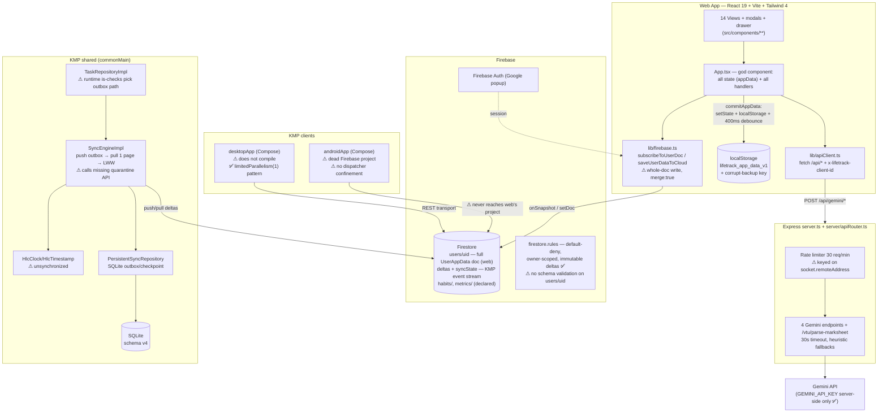

# LifeTrack-Hub — Deep Code Analysis & Improvement Report

| | |
|---|---|
| **Repository** | `github.com/nishanth-kkj9/LifeTrack-Hub` @ `0def13c` (main) |
| **Analysis date** | 2026-10-25 |
| **Scope** | **Every source file** — 163 tracked files, ~35,900 lines of code (excludes README-only analysis per request) |
| **Method** | Full read of all source files: React/TS (48 files), Kotlin Multiplatform shared (30), platform actuals (8), Android/Desktop apps (6), Express server (2), Firebase configs & rules (7), test suites (7 TS/Kotlin groups), Gradle builds (5), project docs (5). Findings verified against source line-by-line. |
| **Format** | Priority table (P0→P2) + per-file findings + before/after fixes |

---

## 1. Executive Summary

LifeTrack-Hub is an ambitious **hybrid codebase**: a polished React 19 web app (tasks, habits, finances, exams, notes, a VTU academics hub) backed by localStorage + a single Firestore document, an Express/Gemini AI sidecar, and a Kotlin Multiplatform (KMP) offline-first sync engine (HLC clocks, outbox pattern, SQLite) with Android/Desktop Compose shells.

The web app **works** and shows real stability engineering (data sanitizer with quarantine, storage-quota surfacing, AI fallbacks, CSV formula-injection escaping). The KMP sync side contains genuinely sophisticated ideas (HLC causality, poison-pill quarantine, bounded backoff) and its test suite is high quality.

**However, the repo is currently broken in ways that no CI would have allowed to ship:**

1. **The KMP shared module, both platform transports, and the desktop app do not compile.** The sync engine calls repository methods (`recordInvalidRemoteDelta`, `getQuarantinedCount`) that do not exist on the `SyncRepository` interface; `SyncRecord` is constructed with named args (`hlcPhysicalTimeMs = …`) that are not constructor parameters; `desktopApp/Main.kt` calls `TasksViewModel(scopeDispatcher = …)` / `dispose()` which don't exist. This proves the code has never been built end-to-end in its current state.
2. **Android is wired to a dead Firebase project** (`galvanic-oarlock-43skh` + a second API key) while web/desktop use `quadratic-chimera-skx2q` — cross-platform sync is architecturally impossible today, despite the README claiming the split was fixed.
3. **`npm ci` fails** because `package-lock.json` is out of sync with `package.json` (jsdom `^30.1.1` vs `^26.1.0`) — the README's own quickstart step is broken.
4. **User-data integrity bugs in the web app:** Kanban/Matrix quick-add and Task "Duplicate" create tasks through an update handler that *never inserts*, so tasks silently vanish; the VTU "Sync Live" button **overwrites the user's real semester data with fabricated pseudo-random marks** while labeling them "Verified / Live Synced".
5. **Zero CI, zero ESLint/Prettier, ad-hoc test scripts** — nothing guards regressions.

The report is organized as requested: a **global P0/P1/P2 priority table** (with effort estimates), **before/after code for every issue class**, an **architecture map**, and a **file-by-file analysis of every file**.

### Health Scorecard

| Area | Grade | Verdict |
|---|---|---|
| Web UI / React components | **C+** | Feature-rich and mostly functional; creation-vs-update path bug, honesty issues, a11y gaps, several 2000-line monoliths |
| Web data layer (firebase.ts, storage) | **B−** | Strong sanitizer/quarantine design; cloud snapshot not sanitized; whole-doc LWW sync risks data loss |
| Express + Gemini server | **B** | Honest fallbacks, timeouts, rate limiting done right; proxy/IP and header hygiene gaps |
| Security posture (web) | **B−** | CSV injection escaped, key kept server-side; but unvalidated import paths, fake-auth UX, no security headers |
| KMP sync engine design | **B+ (design) / F (build)** | Excellent HLC/outbox/quarantine architecture — but does not compile against its own interfaces |
| Android app | **D** | Dead Firebase project, no dispatcher confinement, data-losing fallback, broken keystore API |
| Desktop app | **D** | Does not compile; good dispatcher pattern though |
| Tests | **C** | Kotlin tests strong (65 tests); TS "tests" are ad-hoc scripts, rules test is string-grepping, tests excluded from type-check |
| Config / tooling / CI | **D** | Broken lockfile, no CI, no lint config, engine floor wrong |
| Docs | **C−** | README mostly honest; three "implementation" docs ship stale/contradicted code |

---

## 2. Architecture Map (as actually built)



**Key architectural observations**

- The web app keeps the **entire `UserAppData` in one Firestore document** — simplest possible sync, but last-write-wins at document granularity: two devices editing in parallel lose data, and the doc will hit Firestore's 1 MiB limit long before the KMP delta stream would.
- The KMP side is a **different sync architecture** (event-sourced deltas + HLC) that solves exactly those problems — but targets a different Firebase project on Android and currently doesn't compile. The two halves of the repo have never met.
- `commitAppData` performs persistence **inside the `setAppData` updater** (impure; double-invoked under StrictMode), and every keystroke in the task drawer flows through it.
- Server AI endpoints are the honest part of the system: bounded timeouts, deterministic fallbacks, `isFallbackTemplate` flags, server-side key. This pattern deserves to be copied into the rest of the codebase.

---
## 3. Global Priority Table (P0 → P2)

**Legend** — P0: broken build / data loss / user deception, fix now. P1: security, correctness or UX defect. P2: quality, maintainability, hygiene. Effort is a focused-work estimate for a single developer.

### P0 — Critical (10 items)

| # | Issue | Location | Fix sketch | Effort |
|---|---|---|---|---|
| P0-1 | `SyncRepository` interface lacks `recordInvalidRemoteDelta()` / `getQuarantinedCount()` — engine calls both; **shared module cannot compile**; no `sync_quarantine` table exists | `SyncEngineImpl.kt:237,323` vs `SyncProtocol.kt:136-149`, `PersistentSyncRepository.kt` | Add both methods to interface + impl; add quarantine table to schema v5 | 4h |
| P0-2 | `SyncRecord` constructed with non-existent named args (`hlcPhysicalTimeMs`, `hlcLogicalCounter`, `hlcNodeId`) — **both transports + 3 test files don't compile** | `SyncProtocol.kt:40-56` vs `AndroidFirestoreRemoteSyncTransport.kt:173`, `DesktopFirestoreRestTransport.kt:281`, `HlcOrderingAndPaginationTest.kt:191+`, `SubtaskSyncAndCheckpointTest.kt:255+` | Promote the 3 fields to constructor params (validate against `hlcTimestamp` in `init`) | 2h |
| P0-3 | `desktopApp` does not compile: `TasksViewModel(scopeDispatcher=…)` + `dispose()` don't exist; 8 unresolved Compose/Flow imports | `desktopApp/Main.kt:150,156,179-356` vs `TasksViewModel.kt:58-69` | Add `scopeDispatcher` param + `dispose()`; add missing imports | 2h |
| P0-4 | Android hardcodes **dead Firebase project** `galvanic-oarlock-43skh` (2nd API key, 3rd appId) — contradicts `FirebaseConfig` (`quadratic-chimera-skx2q`); Android can never sync with web/desktop | `LifeTrackApp.kt:55-58,99`, `AndroidFirestoreRemoteSyncTransport.kt:21` (+ 2 desktop defaults) | Route everything through `FirebaseConfig`; delete legacy constants; fix `AndroidProductionWiringTest` tautology | 3h |
| P0-5 | Firebase-unavailable fallback uses `InMemoryRemoteDeltaStore` which **ACKs every push** → engine deletes outbox rows → local edits marked "synced" but stored nowhere (**silent data loss**) | `LifeTrackApp.kt:102-108`, `FirestoreRemoteSyncTransport.kt:75` | Fail closed: keep engine OFFLINE when Firebase init fails; never construct a fake remote | 1h |
| P0-6 | `com.google.gms.google-services` applied with **no `google-services.json`** in repo → Android build fails at execution | `androidApp/build.gradle.kts:5` | Add the file or remove the plugin (Firebase is initialized programmatically) | 0.5h |
| P0-7 | Tasks created from Kanban "+ Add", Matrix "+ Add", and Task "Duplicate" go through `onUpdateTask` — a map-upsert that **never inserts** → silent no-op; UI shows phantom task | `TasksView.tsx:632,657`, `TaskDetailDrawer.tsx:192-205` vs `App.tsx:325-333` | Route creation through `onAddTask`, or make `handleUpdateTask` an upsert | 1h |
| P0-8 | VTU **"Sync Live" overwrites the user's real semesters with fabricated marks** (`baseScore = 78 + rollNum % 17`) labelled "Verified / Live Synced / Real-Time" | `VtuSyncSection.tsx:206` → `vtuData.ts:1057-1133` | Stop persisting synthetic data; explicit demo badge; confirm before overwrite | 4h |
| P0-9 | `package-lock.json` out of sync with `package.json` (jsdom `^30.1.1` vs `^26.1.0`; `@types/jsdom ^30` vs `^21`) → **`npm ci` fails** — README quickstart broken | `package-lock.json:27,33` vs `package.json:45,38` | Regenerate lockfile; pin engines `>=22.12` | 0.5h |
| P0-10 | **No CI at all** (no `.github/workflows/`) — none of P0-1…9 could ever be caught | repo root | Add workflow: npm ci + lint + tests + `gradle :shared:build` + KMP compile check | 3h |

### P1 — High (28 items)

| # | Issue | Location | Fix sketch | Effort |
|---|---|---|---|---|
| P1-1 | Firestore rules: `/users/{uid}` root doc accepts **any shape up to 1 MiB** (no schema validation); `habits/`, `metrics/` unvalidated | `firestore.rules:48-51,70-79` | Add `isValidUserAppData()` mirroring delta validation | 2h |
| P1-2 | **Fake Google sign-in**: Google-styled chooser defaults to hardcoded personal email `chataiwithcode@gmail.com`, forges a `User` object, shows "sync unlocked" promise for the fake path | `GoogleSignInModal.tsx:19-33,214`, `firebase.ts:482-518`, `App.tsx:769,777` | Relabel as "Continue offline (local profile)"; remove hardcoded email; sync promises only for real auth | 2h |
| P1-3 | JSON restore paths skip `sanitizeUserAppData` (SettingsView checks only `tasks` is array; InsightsView's `onRestoreAppData` injects raw file); cloud snapshot also un-sanitized | `SettingsView.tsx:86-107`, `dataExport.ts:156-174`, `InsightsView.tsx:458-470`, `firebase.ts:536-539` | Route every ingestion path through the existing sanitizer | 2h |
| P1-4 | `AndroidSecureStorage` can never work: `storeKey` ignores `keyBytes` (generates random keystore key) and `retrieveKey` calls `getEncoded()` which **always returns null** for AndroidKeyStore keys | `AndroidSecureStorage.kt:18-40` | Redesign as encrypt/decrypt with a keystore-wrapped AES key | 4h |
| P1-5 | HLC clock not thread-safe (`var lastPhysicalTime` RMW); Android wiring runs engine + VM on multi-thread `Dispatchers.Default` → counter races | `HlcClock.kt:85-145`, `LifeTrackApp.kt:111-120` | Copy desktop's `limitedParallelism(1)` confinement or add `Mutex` | 2h |
| P1-6 | Production DBs **seeded with fake tasks** (`seedIfEmpty=true` default) that then sync to the cloud | `PersistentTaskLocalDataSource.kt:40`, `LifeTrackApp.kt:75`, `Main.kt:89` | Default `seedIfEmpty=false`; pass `true` from tests only | 0.5h |
| P1-7 | Hand-rolled `JsonParser` accepts malformed input: EOF→`null` primitive, garbage numbers kept as strings, trailing content ignored, no recursion depth limit | `JsonParser.kt:175,269-278,166-171` | Throw on violation; add depth cap; property-test round-trips | 4h |
| P1-8 | Rate limiter keys on `req.socket.remoteAddress` while `trust proxy` is set → **all users behind the LB share one 30 req/min bucket** | `apiRouter.ts:37` + `server.ts:28` | Use `req.ip` (honors trust proxy) + signed client header as secondary key | 1h |
| P1-9 | AI marksheet import applies unvalidated `any` payload with fabricated defaults (`cieMarks ?? 40`, `gradePoint ?? 8`), empty catch | `VtuSyncSection.tsx:252-302` | Runtime-validate server payload; surface errors; no invented marks | 2h |
| P1-10 | Printable **fake official VTU grade card** (Registrar signature block, hardcoded "FIRST CLASS DISTINCTION", SGPA fallback `\|\| 8.87`) | `VtuSyncSection.tsx:1853-2046,1046,2022` | Derive class from real grades; watermark "SAMPLE — NOT OFFICIAL" | 3h |
| P1-11 | Pomodoro: side effects inside `setTimeLeft` updater (double-fire under StrictMode) + stale `task` closure **reverts logged focus minutes** | `PomodoroFocusModal.tsx:114-126,146-151` | Completion effect + functional updater accumulate | 2h |
| P1-12 | Task drawer persists **on every keystroke** (full `JSON.stringify` + localStorage + 400 ms Firestore write) | `TaskDetailDrawer.tsx:303-306` + `App.tsx:197-220` | Local form state, commit onBlur/debounced | 2h |
| P1-13 | "Monthly budget %" computed from **lifetime** expenses in 3 views → meaningless after month 1 | `FinancesView.tsx:48`, `OverviewView.tsx:77`, `InsightsView.tsx:148` | Filter transactions to current month; extract one shared hook | 1h |
| P1-14 | Pull applies **one 100-record page** then reports SUCCESS; no drain loop | `SyncEngineImpl.kt:212` | `while (page.size == pageSize)` or report `hasMoreRemote` | 1h |
| P1-15 | Push failure `return`s and **skips pull entirely** | `SyncEngineImpl.kt:204` | Continue to pull; push failures are independent | 0.5h |
| P1-16 | **No automatic sync trigger** anywhere (app start, connectivity, post-write) — KMP edits sit in outbox until manual press | engine call-sites | WorkManager/NetworkCallback + post-mutation trigger | 4h |
| P1-17 | SUBTASK success acks never clear parent task's `is_sync_pending` → parent shows pending forever | `PersistentSyncRepository.kt:131` + `PersistentTaskLocalDataSource.kt:245` | Clear parent flag on subtask ack | 1h |
| P1-18 | TasksView search/filter **ignored** by Matrix & Schedule modes (only Kanban gets `filteredTasks`) | `TasksView.tsx:640-671` | Pass `filteredTasks` consistently | 0.5h |
| P1-19 | Daily Schedule hides tasks **before 07:00 / after 22:00** entirely | `DailyScheduleView.tsx:25,72-78` | Clamp into view or add overflow rows | 1h |
| P1-20 | `LifeInsightsPanel`: wrong completion window (lifetime ÷ 4 weeks), **NaN when `targetDaysPerWeek` undefined**, fabricated `|| 50` fallback, all unmemoized ×2 | `LifeInsightsPanel.tsx:22-60` | `useMemo` + guard divisor + reuse shared scoring engine | 1.5h |
| P1-21 | 1-second `setNow` intervals re-render whole Overview & Exams trees | `OverviewView.tsx:54`, `ExamsView.tsx:37` | Extract countdown leaf components | 1h |
| P1-22 | CalendarView rebuilds month grid O(cells × tasks) and re-runs it whenever `selectedDate` changes | `CalendarView.tsx:52-137` | One-pass `Map<dateStr, …>` memo keyed on tasks/exams only | 1h |
| P1-23 | `TaskUseCases`: `require()` inside coroutines with no exception handler → **app crash** on blank title; NL parser misfires (`"see"`→VTU category, `"!"`→urgent) and `relativeDayOffset` never applied | `TaskUseCases.kt:65,164-191`, `TasksViewModel.kt` | Validate-and-return results; add `CoroutineExceptionHandler` | 2h |
| P1-24 | "Firestore rules emulator test" never runs the emulator — pure string greps → false confidence | `test/firestore.rules.emulator.test.ts:44-94` | Rewrite with `@firebase/rules-unit-testing` (owner isolation, cross-user deny, immutability) | 4h |
| P1-25 | TS test infra is ad-hoc scripts: no framework, `process.exit`, no timeouts, tests excluded from `tsc` | `package.json:13`, `tsconfig.json:35` | Adopt Vitest; include tests in type-check | 4h |
| P1-26 | Web↔Firestore whole-doc model: `setDoc(merge:true)` + `lastUpdated` LWW → **two devices overwrite each other's entire dataset**; doc approaches 1 MiB limit | `firebase.ts:558-573`, `App.tsx:109-120` | Short term: `runTransaction` + field-level merge; long term: adopt the KMP delta protocol | 1-3d |
| P1-27 | `generateDueDates` uses `toISOString()` (UTC) breaking the local-date convention + interprets `timesPerWeek` as consecutive days | `schedule.ts:58-84` | Use `getLocalDateString`; fix semantics or delete (mostly unused) | 0.5h |
| P1-28 | Cursor semantics differ across transports: REST `startAt` (inclusive, re-fetches last delta) vs Android `startAfter` vs in-memory `>` | `DesktopFirestoreRestTransport.kt:176-184` vs `AndroidFirestoreRemoteSyncTransport.kt:96-132` | Standardize on exclusive `startAfter` | 1h |

### P2 — Quality / Hygiene (30 items, grouped)

| # | Group | Items (location) | Effort |
|---|---|---|---|
| P2-1 | Dead code | `OperationType`/`FirestoreErrorInfo`/`handleFirestoreError` exported-never-used (`firebase.ts:32-68`); `handleSaveStudentBio` never called (`VtuSyncSection.tsx:224`); `onToggleTask` dead prop in CommandPalette; `onAddExam`/`onAddTransaction` dead props (ExamsView/FinancesView); `scheduleStatus` computed-never-rendered (HabitsView:244); dead `editedNotes`/`editedEstimatedMinutes` state (TaskDetailDrawer); `HlcTimestamp.now()` factory footgun; `SyncEventIdGenerator` ignores `entityId`; `AcademicRepository`/`HabitAndFinanceRepository` have **zero implementations**; `SecureKeyStorage` phase-3 interfaces unused; `DefaultMockRemoteTransport` ships in prod source | 3h |
| P2-2 | Duplication / drift | **Two habit-scoring engines** (`habitScore.ts` vs `habitScoring.ts`) fed different inputs in different views; currency ₹ vs $ (Finances/Insights vs Overview/AddTransactionModal); invalid `border-slate-150` class ×6 files; duplicate Cmd+K listeners (App + CommandPalette); duplicated JSON export logic (SettingsView vs dataExport); 3 Firebase config copies (applet-config JSON / FirebaseConfig.kt / LifeTrackApp.kt); Navigation tab arrays duplicated desktop/mobile; two docs ship the *fixed* `completionRate: 80` bug as current code | 4h |
| P2-3 | `Date.now()`-based IDs | collision risk on rapid creates in 7+ files (`TasksView.tsx:622`, `QuickAddBar`, modals, NotesView:126) → use `crypto.randomUUID()` | 1h |
| P2-4 | A11y | clickable divs without role/tabIndex (habit rows TodayView:643, kanban/matrix cards, TimelineItem/StatCard, OverviewView cards); nested dead button (TodayView); label-less selects; `q` global shortcut fires while modal open (QuickAddBar:44-58); VTU's 3 internal modals skip `useModalFocus` | 4h |
| P2-5 | React correctness | persistence inside `setAppData` updater (StrictMode double-run) (`App.tsx:197-220`); `useModalFocus` self-mutating ref hack (`useModalFocus.ts:25-26`); modals keep stale form state between opens (all 4 Add modals); file input never reset after restore (InsightsView); `RatingChips` remounts every render (DailyLifeCheckinModal:86); check-in drops unknown metric fields (DailyLifeCheckinModal:66-84) | 3h |
| P2-6 | Tailwind/style bugs | `border-slate-150` ×6, `hover:bg-slate-750` (Pomodoro:439), HabitCard inline dark-theme styles break light UI (`HabitCard.tsx:57-66`), LifeDashboard inline-style component | 1h |
| P2-7 | KMP data layer | `SELECT *` + positional cursor mapping (PersistentTaskLocalDataSource:522-611); `applyRemoteTaskUpsert` overwrites `updated_at_epoch_ms` with sync time (:340); unknown enums silently map to defaults (:581-584); N+1 refresh flow (:518-538); migrations not wrapped in transactions (TaskDatabaseSchema:117-130); no compound indexes; `MemorySqlDriver` matches SQL by substring → false test fidelity; per-record Firestore transactions (Android transport:48-75); unbounded pull loop (:96-132); `Double` money (`FinanceModels.kt:24`); locale-sensitive `String.format` (VtuComponents:319); JVM-only `synchronized`/`@Volatile` in commonMain (DeviceIdentity:33, FinanceComponents:184); HLC logical counter `Int` overflow; hex timestamp unpadded breaks lexicographic claim (IdGenerator:26); nodeId `:`/`|` corrupts HLC/cursor strings (HlcTimestamp/SyncProtocol:92); `recordSuccessAcks` per-row loops; `updateSyncCheckpoint` non-atomic | 8h |
| P2-8 | Android/desktop hygiene | `allowBackup=true` with no rules → device identity + HLC DB restored cross-device (AndroidManifest:9); stock icon; no signing/minify for release (androidApp/build.gradle.kts:20-25); desktop driver never closed on exit; `DesktopFirebaseAuthSessionProvider` plain vars w/o `@Volatile`, swallows refresh errors and returns expired token; REST `errorStream` never drained; `AndroidSqlDriver` binds all args as strings; dual versioning systems (user_version vs schema_version) | 4h |
| P2-9 | Server | no CORS/security headers (add `helmet`); AI endpoints unauthenticated (rate-limit only); `/vtu/parse-marksheet` numeric fields unvalidated; Gemini JSON fallback line-splitting untested; in-memory rate limit is per-instance only | 2h |
| P2-10 | Config/tooling | tsconfig missing `noUnusedLocals/noUncheckedIndexedAccess`, `exclude:["test"]` hides test type-errors; engines floor `>=20.19` vs jsdom-30 chain needing 22; `.gitignore` missing `server.js`, `.kotlin/`, `*.db`, `.firebase/`; no ESLint/Prettier/EditorConfig/CONTRIBUTING/SECURITY.md/CODEOWNERS; KGP/AGP mismatch silenced via `nowarn` instead of upgraded (Kotlin 1.9.23/AGP 8.3.2) | 3h |
| P2-11 | Honesty / UX polish | Header tooltip promises "Multi-device sync active" for fake local profiles; TodayView 4th metric card hardcoded "Healthy / on budget" while `budget` prop unused (TodayView:362-393); AcademicsView silent `() => {}` fallbacks + fabricated fallback profile; fake "Join Channel"/"Download" actions (VtuSyncSection:386,1804); hardcoded USN `1MS22CS084` ×8 locations; Overview "done today" counts all-time; "Add task for this day" ignores selected date (CalendarView:547); past exams never archived; delete actions lack confirmation (Finances/Notes); AddTransactionModal income defaults to "Food & Dining"; income label "Amount ($)" | 5h |
| P2-12 | Docs truth-check | README:14 claims unified Firebase project (false for Android); README:98 "13 KMP suites" (16 files/65 tests); README:109 references nonexistent `docs/ANALYSIS.md`; FEATURE_IMPROVEMENT_ANALYSIS claims GPL-3.0 (repo is MIT); COMPLETE_IMPLEMENTATION/IMPLEMENTATION_FILES ship stale code + nonexistent `src/types/tracking.ts`; ENCRYPTION_BOUNDARY is accurate ✅ | 2h |

---
## 4. P0 Deep Dives — Before / After

### P0-1 · Sync engine calls methods that don't exist (shared module cannot compile)

**Evidence** — `SyncEngineImpl.kt:237,323`:

```kotlin
val quarantined = syncRepository.recordInvalidRemoteDelta(...)   // ← not on interface
val quarantinedTotal = syncRepository.getQuarantinedCount()      // ← not on interface
```

`SyncProtocol.kt:136-149` defines `SyncRepository` with only outbox/checkpoint methods. There is also **no `sync_quarantine` table** in `TaskDatabaseSchema.kt`, so the engine's poison-pill design (quarantine after 3 failed apply attempts) has no storage.

❌ Current: engine references two phantom methods; any `gradle :shared:build` fails.

✅ Fix — extend the contract and implement it:

```kotlin
// SyncProtocol.kt
interface SyncRepository {
    // …existing methods…
    suspend fun recordInvalidRemoteDelta(delta: SyncRecord, reason: String): Int
    suspend fun getQuarantinedCount(): Int
}
```

```sql
-- TaskDatabaseSchema.kt (v5 migration)
CREATE TABLE IF NOT EXISTS sync_quarantine (
    delta_id TEXT PRIMARY KEY,
    entity_id TEXT NOT NULL,
    entity_type TEXT NOT NULL,
    payload TEXT NOT NULL,
    failure_reason TEXT NOT NULL,
    attempt_count INTEGER NOT NULL DEFAULT 1,
    first_seen_ms INTEGER NOT NULL,
    last_seen_ms INTEGER NOT NULL
);
```

Then implement both methods in `PersistentSyncRepository` with parameterized SQL (the file already does this consistently elsewhere) and add a v5 migration entry.

---

### P0-2 · `SyncRecord` constructor mismatch across transports and tests

**Evidence** — `SyncProtocol.kt:40-56` defines computed getters:

```kotlin
data class SyncRecord(
    val id: String, val entityType: String, val entityId: String,
    val operation: String, val payload: String, val hlcTimestamp: String,
    // hlcPhysicalTimeMs etc. are `get() =` accessors, NOT constructor params
)
```

…while `AndroidFirestoreRemoteSyncTransport.kt:173`, `DesktopFirestoreRestTransport.kt:281` and 3 test files construct:

```kotlin
SyncRecord(id = …, hlcTimestamp = …, hlcPhysicalTimeMs = 1720000009999L, // ← unresolved
           hlcLogicalCounter = …, hlcNodeId = …)
```

✅ Fix — promote to constructor params and keep the getters as validated aliases:

```kotlin
data class SyncRecord(
    val id: String,
    val entityType: String,
    val entityId: String,
    val operation: String,
    val payload: String,
    val hlcTimestamp: String,
    val hlcPhysicalTimeMs: Long,     // now constructor params
    val hlcLogicalCounter: Int,
    val hlcNodeId: String,
) {
    init {
        val parsed = HlcTimestamp.fromString(hlcTimestamp)
        require(parsed.physicalTimeMs == hlcPhysicalTimeMs &&
                parsed.logicalCounter == hlcLogicalCounter &&
                parsed.nodeId == hlcNodeId) {
            "SyncRecord ${id}: hlc fields inconsistent with hlcTimestamp"
        }
    }
}
```

Single-point validation means a corrupted payload fails at construction, not three layers deep.

---

### P0-3 · Desktop app references `TasksViewModel` API that doesn't exist

**Evidence** — `desktopApp/Main.kt:150,156`:

```kotlin
TasksViewModel(…, scopeDispatcher = dbDispatcher)   // ← no such parameter
onDispose { viewModel.dispose() }                   // ← no such method
```

✅ Fix — `TasksViewModel.kt`:

```kotlin
class TasksViewModel(
    …,
    private val scopeDispatcher: CoroutineDispatcher = Dispatchers.Default
) {
    // Confined scope: solves BOTH the dispose leak and the HLC race (P1-5)
    private val viewModelScope =
        CoroutineScope(SupervisorJob() + scopeDispatcher)

    fun dispose() { viewModelScope.cancel() }
}
```

Also add the 8 missing imports in `Main.kt` (`Button`, `ButtonDefaults`, `Card`, `CardDefaults`, `OutlinedTextField`, `PaddingValues`, `PasswordVisualTransformation`, `MutableStateFlow`).

---

### P0-4 · Android points at a dead Firebase project

**Evidence** — `LifeTrackApp.kt:55-58,99` vs `FirebaseConfig.kt:27`:

```kotlin
// LifeTrackApp.kt — the ONLY client on this project
.setProjectId("galvanic-oarlock-43skh")     // dead project
.setApiKey("AIza…second-key…")              // different key
.setStorageBucket("galvanic-oarlock-43skh.firebasestorage.app")
…
FirestoreRemoteSyncTransport(projectId = "galvanic-oarlock-43skh", …)

// FirebaseConfig.kt — claims to be the "SINGLE SOURCE OF TRUTH"
const val PROJECT_ID = "quadratic-chimera-skx2q"
```

Three app IDs, two API keys, two projects coexist. `AndroidProductionWiringTest.kt:56-64` *asserts local constants to themselves*, cementing the stale ID as "canonical".

✅ Fix:

```kotlin
// LifeTrackApp.kt
val cfg = FirebaseConfig()
FirebaseApp.initializeApp(this,
    FirebaseOptions.Builder()
        .setProjectId(cfg.projectId)
        .setApiKey(FirebaseConfig.CLIENT_API_KEY)
        .setApplicationId(FirebaseConfig.ANDROID_APPLICATION_ID) // fill the real value
        .build())

// Transports: remove default projectId params entirely so wiring cannot
// accidentally fall back to the dead project.
```

Delete the legacy constants, make `AndroidProductionWiringTest` assert `FirebaseConfig.PROJECT_ID` is what the `FirebaseApp` options contain, and update `firebase-applet-config.json` ↔ `FirebaseConfig.kt` so exactly **one** config exists per platform surface.

---

### P0-5 · Fallback transport ACKs pushes into a black hole (silent data loss)

**Evidence** — `LifeTrackApp.kt:102-108`:

```kotlin
// When Firebase init fails:
FirestoreRemoteSyncTransport(
    authSessionProvider = authSessionProvider,
    remoteDeltaStore = InMemoryRemoteDeltaStore()   // ← in-memory fake
)
```

`InMemoryRemoteDeltaStore` accepts every push → engine calls `recordSuccessAcks` → outbox rows are **deleted** and `is_sync_pending` cleared. Edits vanish on process death, falsely marked synced.

❌ Current: fail-open fake success.
✅ Fix: fail closed — never construct a remote that lies:

```kotlin
val syncEngine = if (firebaseReady) {
    SyncEngineImpl(…, transport = AndroidFirestoreRemoteSyncTransport(…))
} else {
    SyncEngineImpl(…, transport = UnavailableRemoteTransport) // push() throws OfflineException
}
```

The engine already handles push failure by retrying with backoff (`PersistentSyncRepository` bounded backoff) — that's the correct behavior. The fake must go.

---

### P0-6 · google-services plugin without `google-services.json`

**Evidence** — `androidApp/build.gradle.kts:5` applies `com.google.gms.google-services`; `**/google-services.json` matches nothing in the repo → the build fails at configuration/execution.

✅ Fix (choose one):

```kotlin
// Option A: add androidApp/google-services.json (gitignored, from Firebase console)
// Option B: since LifeTrackApp initializes Firebase programmatically:
plugins {
    alias(libs.plugins.android.application)
    // remove: alias(libs.plugins.google.services)   // ← delete
}
```

---

### P0-7 · "Create task" paths silently drop the task

**Evidence** — `App.tsx:325-333` is a pure replace:

```tsx
const handleUpdateTask = (updatedTask: Task) => {
  commitAppData((prev) => ({
    ...prev,
    tasks: prev.tasks.map((t) => (t.id === updatedTask.id ? updatedTask : t)),
  }));                                       // ← new ids never match → never inserted
};
```

…while `TasksView.tsx:632,657` (Kanban/Matrix quick-add) and `TaskDetailDrawer.tsx:192-205` (Duplicate) build a **new** task and call `onUpdateTask(newTask)`. Result: nothing persists; the drawer then opens a phantom task.

✅ Fix — make the handler an upsert (defensive, fixes all 3 call sites at once):

```tsx
// App.tsx
const handleUpdateTask = (updatedTask: Task) => {
  commitAppData((prev) => {
    const exists = prev.tasks.some((t) => t.id === updatedTask.id);
    return {
      ...prev,
      tasks: exists
        ? prev.tasks.map((t) => (t.id === updatedTask.id ? updatedTask : t))
        : [updatedTask, ...prev.tasks],
    };
  });
  if (selectedDetailTask?.id === updatedTask.id) setSelectedDetailTask(updatedTask);
};
```

And additionally route Kanban/Matrix creation through `onAddTask` (which semantically means "create") for clarity.

---

### P0-8 · VTU "Sync Live" replaces real data with fabricated marks

**Evidence** — `VtuSyncSection.tsx:206` defers into `vtuData.ts:1057-1133`:

```ts
const baseScore = 78 + (rollNum % 17); // 78 to 94   ← pseudo-random transcript generator
```

…then the UI announces *"Synchronized with VTU Karnataka Database!"*, *"Verified Profile"*, *"Live Synced"* — and the generated semesters **replace** whatever real SGPA data the user had entered or imported. There is no confirmation dialog and no demo-data marker.

✅ Fix (three layers):

```tsx
// 1. Never silently overwrite: merge + confirm
const confirmed = window.confirm(
  "Demo sync will REPLACE your current semester data with simulated records. Continue?"
);
if (!confirmed) return;

// 2. Mark provenance in the profile
const syncedProfile = {
  ...syncVtuProfileFromStudentRecord(profile.usn),
  dataSource: 'simulated' as const,     // render a "DEMO DATA" badge everywhere
};

// 3. Stop claiming external authority: rename all
//    "Verified / Real-Time / Official" copy to "Simulated demo data".
```

Same treatment applies to the printable grade card (P1-10).

---

### P0-9 · Lockfile drift breaks `npm ci`

**Evidence** — `package-lock.json:27,33` vs `package.json:45,38`:

```json
// package-lock root:            // package.json:
"@types/jsdom": "^30.0.0",       "@types/jsdom": "^21.1.7",
"jsdom": "^30.1.1",              "jsdom": "^26.1.0",
```

`npm ci` exits `EUSAGE` ("lock file out of sync") — README step 1 fails. The lock root also misclassifies dev-only packages as prod dependencies.

✅ Fix: `rm -rf node_modules && npm install && git add package-lock.json`, then raise `"engines": { "node": ">=22.12" }` (jsdom 30's transitive `@asamuzakjp/css-color` requires ≥22.22 / 24 / 26 — Node 20 emits EBADENGINE).

---

### P0-10 · Zero CI — add a guardrail workflow

✅ `.github/workflows/ci.yml`:

```yaml
name: CI
on: [push, pull_request]
jobs:
  web:
    runs-on: ubuntu-latest
    steps:
      - uses: actions/checkout@v4
      - uses: actions/setup-node@v4
        with: { node-version: 22, cache: npm }
      - run: npm ci
      - run: npm run lint          # tsc --noEmit (include test/ — see P1-25)
      - run: npm test
  kotlin:
    runs-on: ubuntu-latest
    steps:
      - uses: actions/checkout@v4
      - uses: actions/setup-java@v4
        with: { distribution: temurin, java-version: 17 }
      - run: ./gradlew :shared:build --stacktrace   # would fail TODAY = catches P0-1/2
      - run: ./gradlew :desktopApp:build            # catches P0-3
```

This single file would have caught **every P0 in this report**.

---
## 5. Key P1 Deep Dives — Before / After

### P1-1 · Firestore rules accept arbitrary payloads on the web doc

**Evidence** — `firestore.rules:48-51`:

```
match /users/{userId} {
  allow read: if isOwner(userId);
  allow create, update, delete: if isValidId(userId) && isOwner(userId);
  // ← no request.resource.data validation at all (1 MiB blob surface)
}
```

✅ Fix — mirror the delta validation the rules file already does well:

```
function isValidUserAppData() {
  return request.resource.data.keys().hasAll(['tasks','transactions','budget','exams','habits','notes'])
    && request.resource.data.tasks.size() <= 500
    && request.resource.data.transactions.size() <= 2000
    && request.resource.data.lastUpdated is number;
}
match /users/{userId} {
  allow create, update: if isOwner(userId) && isValidUserAppData();
}
```

---

### P1-2 · Deceptive fake Google sign-in

**Evidence** — `GoogleSignInModal.tsx:19,31` + `firebase.ts:482-518`:

```ts
export function createGoogleUserProfile(email = 'chataiwithcode@gmail.com', …): User {
  return { uid: `local_${safeId}`, isAnonymous: true, providerId: 'local', …
  } as unknown as User;                      // ← forged Firebase User
}
```

The modal clones Google's account chooser, defaults to a hardcoded personal Gmail, and the same "Signing in unlocks sync across devices…" promise shows for the fake path. `App.tsx:769,777` hardcodes the email twice more.

✅ Fix:

```tsx
// GoogleSignInModal.tsx
<button onClick={() => onContinueLocal()}>          // honest label
  Continue without an account (offline)
</button>
<button onClick={onTryFirebasePopup}>               // real Google flow
  <GoogleIcon /> Sign in with Google
</button>
```

- Delete `defaultEmail='chataiwithcode@gmail.com'` (and the two call sites in App.tsx); generate a neutral "Local Profile".
- Only the real-Firebase success path may display sync-promising copy.
- Keep `createGoogleUserProfile` for the offline path but stop styling it as Google authentication.

---

### P1-3 · Unvalidated ingestion paths bypass the sanitizer

**Evidence** — three trust boundaries skip `sanitizeUserAppData` (which exists and is good):

```ts
// SettingsView.tsx:95
if (parsed && Array.isArray(parsed.tasks)) { onRestoreData(parsed); … }   // minimal check

// dataExport.ts:166
resolve(parsed as UserAppData);                    // pure cast

// firebase.ts:538 — cloud snapshot straight into state
const cloudData = snapshot.data() as UserAppData;  // onUpdate(cloudData)
```

✅ Fix — one ingestion gate:

```ts
// firebase.ts
onSnapshot(userRef, (snapshot) => {
  if (snapshot.exists()) {
    const { data } = sanitizeUserAppData(snapshot.data());  // ← same gate as local load
    onUpdate(data);
  }
  …
});
```

```ts
// App.tsx — handleRestoreData already sanitizes; route BOTH UI import paths
// (SettingsView + InsightsView) through onRestoreData, and delete the raw
// onRestoreAppData path.
```

---

### P1-5 · HLC clock races on Android

**Evidence** — `HlcClock.kt:109-140`:

```kotlin
class StandardHlcClock(…) : HlcClock {
  private var lastPhysicalTime: Long = …   // plain var, no synchronization
  override suspend fun now(): HlcTimestamp { … lastPhysicalTime = … }  // RMW
```

Desktop wires the engine + VM onto `Dispatchers.Default.limitedParallelism(1)` (correct). `LifeTrackApp.kt:111-120` passes **no dispatcher** → everything runs on the default multi-thread pool → lost counter updates and duplicate HLCs break LWW ties.

✅ Fix (either):

```kotlin
// LifeTrackApp.kt — replicate the desktop pattern
val dbDispatcher = Dispatchers.Default.limitedParallelism(1)
SyncEngineImpl(…, ioDispatcher = dbDispatcher)
TasksViewModel(…, scopeDispatcher = dbDispatcher)   // after P0-3 fix
```

or make the clock safe by construction:

```kotlin
private val mutex = Mutex()
override suspend fun now(): HlcTimestamp = mutex.withLock { …advance… }
```

---

### P1-7 · Hand-rolled JsonParser is lenient where sync correctness depends on strictness

**Evidence** — `JsonParser.kt`:

```kotlin
if (pos >= src.length) return JsonPrimitive(null)        // L175: EOF → "valid" null
val num: Any = numStr.toLongOrNull() ?: numStr.toDoubleOrNull()
             ?: numStr                                    // L269: "--1" parses fine (as string)
// L166: trailing junk after top-level value is ignored
// parseValue has no recursion depth limit → StackOverflow on hostile payload
```

✅ Fix:

```kotlin
private fun parseValue(): JsonValue {
    if (depth++ > MAX_DEPTH) throw JsonParseException("Nesting too deep at $pos")
    try { … } finally { depth-- }
}

// EOF: throw IllegalArgumentException("Unexpected end of input at $pos")
// Numbers: validate RFC 8259 grammar with a regex before toLong/toDouble
// After top-level value: require(pos == src.length)
```

Then add a property/round-trip test file — this parser gates **every** sync payload on every platform.

---

### P1-8 · Rate limiter collapses all proxied users into one bucket

**Evidence** — `server.ts:28` sets `app.set('trust proxy', 1)` (deployment target is Render/Cloud Run per comments), but `apiRouter.ts:37` then keys on:

```ts
const ip = req.socket.remoteAddress || req.ip || 'anonymous-client';
```

Behind a reverse proxy every client shares the LB's socket address → one 30-req/min bucket for everyone.

✅ Fix:

```ts
const ip = req.ip || req.socket.remoteAddress || 'unknown'; // req.ip honors trust proxy
```

`req.ip` with `trust proxy: 1` uses the last hop set by *your own* infrastructure and cannot be spoofed by client `X-Forwarded-For` (that's the actual threat the original code was defending against — Express drops untrusted hops).

---

### P1-11 · Pomodoro logs minutes that later vanish, and double-fires under StrictMode

**Evidence** — `PomodoroFocusModal.tsx:114-126,146-151`:

```tsx
setTimeLeft((prev) => {
  if (prev <= 1) { clearInterval(…); handleTimerComplete(); … }  // ← effects in updater
});
// later, on close:
onUpdateTask({ ...task, actualMinutes: (task.actualMinutes || 0) + elapsedMinutes });
//                              ^^^^^ stale prop → reverts the earlier increment
```

✅ Fix:

```tsx
// 1) Pure updater + completion effect
useEffect(() => {
  if (timeLeft === 0 && isRunning) handleTimerComplete();
}, [timeLeft, isRunning]);

// 2) Accumulate functionally via a dedicated App handler
onAddFocusMinutes(task.id, elapsedMinutes);

// App.tsx
const handleAddFocusMinutes = (taskId: string, minutes: number) =>
  commitAppData((prev) => ({
    ...prev,
    tasks: prev.tasks.map((t) =>
      t.id === taskId ? { ...t, actualMinutes: (t.actualMinutes || 0) + minutes } : t),
  }));
```

---

### P1-13 · "Monthly budget %" uses lifetime expenses (3 views)

**Evidence** — `FinancesView.tsx:48` (identical in `OverviewView.tsx:77`, `InsightsView.tsx:148`):

```ts
const totalExpense = transactions.filter((t) => t.type === 'expense')
  .reduce((sum, t) => sum + t.amount, 0);          // ← ALL TIME
const budgetUsed = budget.monthlyBudget > 0 ? (totalExpense / budget.monthlyBudget) * 100 : 0;
```

✅ Fix — one shared hook, month-scoped:

```ts
// src/hooks/useMonthlyFinance.ts
export function useMonthlyFinance(transactions: Transaction[], budget: BudgetSettings) {
  return useMemo(() => {
    const month = new Date().toISOString().slice(0, 7); // YYYY-MM
    const monthly = transactions.filter((t) => t.date.startsWith(month));
    const income  = monthly.filter((t) => t.type === 'income').reduce((s, t) => s + t.amount, 0);
    const expense = monthly.filter((t) => t.type === 'expense').reduce((s, t) => s + t.amount, 0);
    return { income, expense, budgetUsedPct: budget.monthlyBudget > 0 ? (expense / budget.monthlyBudget) * 100 : 0 };
  }, [transactions, budget]);
}
```

---

### P1-14/15/16 · Sync engine pull/push semantics

**Evidence** — `SyncEngineImpl.kt:204,212`:

```kotlin
// push fails → whole sync aborts, pull never runs:
if (!pushResult.success) return SyncResult(…)
// pull applies a single page:
pullRecordsWithCursor(cursor, pageSize = 100)   // >100 remote deltas = "SUCCESS" lie
```

✅ Fix:

```kotlin
// 1) Pull is independent of push:
val pushResult = pushOutbox()            // may fail — keep going
val pullResult = pullAllPages(cursor)

// 2) Drain loop inside one sync:
var cursor = repo.getCheckpoint()
do {
    val page = transport.pullRecordsWithCursor(cursor, pageSize = PAGE)
    page.forEach { applyRemoteDelta(it) }
    cursor = page.lastOrNull()?.let { SyncCursor.from(it.hlcTimestamp) } ?: break
} while (page.size == PAGE)

// 3) Auto-triggers (Android):
//  - WorkManager periodic + NetworkType.CONNECTED constraint
//  - engine.triggerSync() after every successful mutation
//  - ConnectivityManager callback → triggerSync() on regain
```

---

### P1-18/19 · TasksView filter and DailySchedule time window

**Evidence**:

```tsx
// TasksView.tsx:640-671 — Kanban filtered, Matrix/Schedule not:
<EisenhowerMatrixView tasks={tasks} … />          // ← raw list
<DailyScheduleView tasks={tasks} … />             // ← raw list
<KanbanBoardView tasks={filteredTasks} … />       // ← filtered

// DailyScheduleView.tsx:25 — hard window:
const HOURS = Array.from({ length: 16 }, (_, i) => i + 7);   // 07:00–22:00 only
```

✅ Fix: pass `filteredTasks` to all three views; in DailySchedule, clamp into view:

```ts
const dayTasks = useMemo(() => {
  const visible = tasks.filter((t) => {
    if (!t.dueTime) return false;
    const h = Number(t.dueTime.slice(0, 2));
    return h >= WINDOW_START && h < WINDOW_END;
  });
  const overflow = tasks.filter((t) => t.dueTime && !visible.includes(t));
  return { visible, overflow };   // render "Earlier (n)" / "Later (n)" trays
}, [tasks]);
```

---
## 6. File-by-File Analysis — Web App

Cross-references like *(→ P0-7)* point to the priority table / deep dives. Line numbers are from the analyzed tree.

### 6.1 Root & tooling

| File | Verdict |
|---|---|
| `package.json` | Scripts well-organized (`dev` runs tsx server + Vite middleware; granular test:* scripts). **P0-9**: jsdom/`@types/jsdom` versions conflict with lockfile. **P2-10**: engines floor too low for jsdom-30 chain; `lint` is only `tsc --noEmit` and excludes tests. |
| `package-lock.json` | Out of sync with package.json (root deps disagree) — `npm ci` fails (→ P0-9). |
| `tsconfig.json` | `strict: true` ✅. Missing `noUnusedLocals/noUnusedParameters/noUncheckedIndexedAccess`; `exclude:["test"]` means `npm run lint` never type-checks the 5 test files (→ P1-25). |
| `vite.config.ts` | Clean: `@` alias, manual vendor chunking (firebase/react/icons/animations), chunk limit 600. `hmr:false` documented for AI-Studio iframe. No issues. |
| `index.html` | Solid meta/OG tags, font preconnect. No CSP meta tag (P2-9 territory); otherwise fine. |
| `.env.example` | Correctly lists only `GEMINI_API_KEY` (server-side) — matches the honest key story. |
| `.gitignore` | Covers node_modules/dist/.env*/gradle dirs; missing `server.js`, `.kotlin/`, `*.db`, `.firebase/` (P2-10). |
| `LICENSE` | MIT — note `FEATURE_IMPROVEMENT_ANALYSIS.md` claims GPL-3.0 (P2-12). |
| `metadata.json` | AI-Studio preview metadata; harmless. |
| `gradle.properties` | `kotlin.mpp.androidGradlePluginCompatibility.nowarn=true` silences the KGP/AGP mismatch instead of fixing it (P2-10). |
| `settings.gradle.kts` / `gradlew` / `gradlew.bat` / wrapper | Standard; fine. |

### 6.2 Server

**`server.ts` (95 ln)** — Process-level `unhandledRejection` warn + `uncaughtException` exit, `trust proxy`, graceful shutdown with 10s hard-kill, error handler last. Quality work. Issues: `/api/health` is registered *after* `app.use('/api', apiRouter)` — works only because the router has no catch-all; move it above the router for clarity. No security headers/CORS policy (P2-9). The rate-limiter IP bug lives in the router (→ P1-8).

**`server/apiRouter.ts` (626 ln)** — Best-practices showpiece *and* a lesson file:
- ✅ `express.json({limit:'2mb'})`, sliding-window limiter with cleanup + `unref`, `Retry-After` header, `withTimeout` guard on every Gemini call, safe diagnostics logging (no PII, no key echo), input slicing (`safeTitle`, `safeUsnHint`), honest `isFallbackTemplate` fallbacks with **empty** fabricated sources, heuristic subtask generator, marksheet parser requiring manual verification.
- ❌ Limiter keys on `req.socket.remoteAddress` under `trust proxy` (→ P1-8); AI endpoints unauthenticated beyond IP limiting (acceptable, but consider requiring an app check); `/vtu/parse-marksheet` doesn't validate numeric types in the parsed payload (a string `sgpa` passes through); the `rawText.slice(0,4000)` prompt-embedded raw text permits prompt injection into the marksheet schema (mitigated by `requiresManualVerification`).

### 6.3 App core

**`src/main.tsx` (19 ln)** — StrictMode + ErrorBoundary + dev-only error filter (tree-shaken). Correct. No issues.

**`src/App.tsx` (781 ln)** — God component: 10 pieces of modal state, every domain handler, sync lifecycle, keyboard shortcuts, all 9 views + 7 overlays inline.
- (→ P0-7) `handleUpdateTask` is replace-not-upsert; Kanban/Matrix/Duplicate rely on it.
- `commitAppData` (197-220): side effects (`saveLocalData`, cloud timer) **inside the `setAppData` updater** — impure, double-invoked under StrictMode; move persistence to a `useEffect` on `appData`.
- Conflict guard (108-120): skips remote snapshot if a save is pending — good intent — but combined with `setDoc(merge:true)` + `lastUpdated` LWW (→ P1-26) two devices still clobber each other whole-hog.
- Auth effect (80-154): restores `lifetrack_local_user` from JSON.parse with no shape validation (spoofable locally; sanitize like `sanitizeUserAppData`).
- `handleToggleTask` force-completes all subtasks when the parent is completed (317) but the reverse un-completion isn't symmetric (TaskDetailDrawer P2 note).
- `urgentExamsCount` (502-506): `new Date(\`${e.examDate}T${e.examTime}\`)` throws on malformed imported data → wrap in a safe parse (error boundary would catch it app-wide otherwise).
- Sync-notice click routing by `syncNotice.includes('authorization')` string matching (539-544) — brittle; use a structured notice object `{ kind: 'auth-domain', text }`.
- Hardcoded `'chataiwithcode@gmail.com'` at 769/777 (→ P1-2).
- `handleRestoreAppData` (433-446) merges restored fields over current state **without sanitizing** (→ P1-3) and `||` fallbacks mean an empty restored array never clears existing data — surprising semantics.

**`src/types/index.ts` (331 ln)** — Single shared type module, well-organized unions and interfaces. `VtuProfile.attendanceThreshold: 85 | 75` literal union is nice. Gaps: `Task.dueDate`/`dueTime` are plain strings (documented, acceptable); `Habit.habitScore/habitHealth` are persisted derived state — two engines write them (→ P2-2); `DailyLifeMetric` field names (`moodLevel` vs `analytics.ts`'s `mood`) forced adapter code in 2 call sites — align `DailyMetricLike` with the real type and delete the adapters.

**`src/index.css`** — Tailwind 4 entry; fine.

**`src/vite-env.d.ts`** — Standard; fine.

### 6.4 `src/lib/` (13 files)

| File | Analysis |
|---|---|
| `firebase.ts` (573) | The web data layer. ✅ `sanitizeUserAppData` defensive coerctions + corrupt-payload quarantine key; quota-exceeded surfaces a user-visible event; uid/ownership double-check in `saveUserDataToCloud`. ❌ Cloud snapshot not sanitized (→ P1-3); `setDoc(merge:true)` whole-doc LWW (→ P1-26); `createGoogleUserProfile` forged `User` + hardcoded email (→ P1-2); dead exports `OperationType`/`FirestoreErrorInfo`/`handleFirestoreError` (P2-1); `INITIAL_DATA` sample rows constructed at module import (harmless but wasteful — build lazily inside `getDemoData`). |
| `apiClient.ts` (135) | Clean fetch wrapper; client-id header; graceful client-side subtask fallback when server unreachable. ❌ `requestFinanceInsights/StudyGuide/DeepPlan` throw raw — callers vary in handling; `requestDeepPlan` returns `data.plan` untyped `any[]` params (types/index has better shapes). |
| `dateUtils.ts` (148) | Local-timezone discipline is **good** (no UTC drift). `getDatesInRange` mutates `current` in loop (fine); `daysAgo` uses raw time diff — DST edge; `getWeekStart` mutates input date copy via setDate (fine). |
| `todoUtils.ts` (553) | NLP parser mostly good (tags, priority, recurrence, relative dates). **Bug**: time extractor regex `(?:at\|@)?\s*(\d{1,2})…` + `text.includes('at ')` anywhere → *"Finish chapter 10 at library"* parses `10` as a time → `dueTime:'10:00'` stripped from title. Require the `at|@` anchor adjacent to the number. Audio engine (FocusSoundEngine) is well-built pink-noise/binaural synth with lazy ctx + resume. Confetti respects `disableForReducedMotion` ✅. `TASK_TEMPLATES` data is fine. |
| `habitScore.ts` (67) | Scoring engine #1 (`calculateHabitScore`). Deterministic, clamped. `calculateOverallCompletionRate(any[])` uses `any` + a magic `* 4` window (→ P1-20 family). |
| `habitScoring.ts` (160) | Scoring engine #2 (`analyzeHabitStrength`, Loop-style exponential). Better algorithm; **both are used in different views** → same habit shows different % (→ P2-2). Merge into one, keep the Loop-style one for display, delete the other. |
| `schedule.ts` (147) | `calculateHabitStreaks` is correct (today/yesterday grace). `generateDueDates` (→ P1-27) UTC `toISOString()` + `timesPerWeek`-as-days semantics bug; `computeHabitStatus`/`computeAdaptiveSchedule` fine but `skippedDates` has no producer anywhere (feature gap). |
| `analytics.ts` (139) | `summarizeWeeklyMetrics` reads `mood/energy/sleepHours` — matches only via adapter mapping in callers; the `DailyMetricLike` interface should just reuse `DailyLifeMetric` (renamed fields). Honest `completionRate: 0` with explanatory comment (previously hardcoded 80 — docs still ship the bug, → P2-12). |
| `correlationEngine.ts` (178) | Pearson math correct; zero-variance guard `denominator === 0` ✅; simulated insights flagged `isSimulated` and sample-badged (honesty ✅). Pair 3 (`Hydration`) labels *any* r ≥ 0.4 "Strong Positive", 0.39 "Moderate Positive" — thresholds asymmetric with pair 1; minor. |
| `dataExport.ts` (174) | CSV formula-injection sanitizer ✅ (rare to see). JSON import is a bare cast (→ P1-3). CSV quoting handles embedded quotes/objects. `downloadFile` revokes object URL ✅. |
| `devErrorFilter.ts` (37) | Dev-only console noise filter, tree-shaken from prod (replaces a prod-enabled inline script — good fix). Fine. |
| `vtuData.ts` (1191) | Large seed/reference dataset + **`syncVtuProfileFromStudentRecord` fabricates transcripts** (`baseScore = 78 + rollNum % 17`, → P0-8). Syllabus/PYQ datasets are hardcoded snapshots presented with "browse" affordances — fine if labeled; several views imply liveness they don't have. |
| `vtuSyncData.ts` (866) | Companion dataset (events, internships, resources). Static data, no external calls despite "Sync" naming. Label as demo directory. |

### 6.5 `src/hooks/` (2 files)

| File | Analysis |
|---|---|
| `useHabitManager.ts` (131) | CRUD over habits + scoring on every mutation using engine #1 + `calculateHabitStreaks`. Recomputes scores for **all** habits on any toggle (fine at current scale). Uses `onUpdate([...habits])` callbacks — closure over `habits` prop is current-render-fresh because App re-renders first; safe but fragile pattern. |
| `useModalFocus.ts` (102) | Focus trap: visibility-filtered Tab cycling, Escape close, focus restore — genuinely good. Issues (P2-5): self-mutating ref alias `(containerRef as any).modalRef = containerRef` every render; `initialFocusRef` in deps re-runs effect each parent render; `offsetParent` check breaks for `position: fixed` containers. |

### 6.6 `src/components/` — shell & primitives

| File | Analysis |
|---|---|
| `Header.tsx` (198) | Auth/sync status display; ❌ tooltip promises "Multi-device sync active" for fake local profiles (→ P1-2 family); otherwise clean. |
| `Navigation.tsx` (422) | Desktop tabs + mobile "More" sheet, badge counts. Escape/outside-click cleanup correct. Tab arrays duplicated 3× (P2-2); `ActiveTab` includes legacy `overview/vtu/exams` only to normalize away. |
| `common/ErrorBoundary.tsx` (105) | **The best web file in the repo**: quarantines corrupt localStorage to a backup key before reload, offers reset, dev-only stack. No issues. |
| `common/CommandPalette.tsx` (436) | Fuzzy search across tasks/exams/habits/notes + actions. ❌ second Cmd+K listener duplicates App's (toggle vs open — fragile, P2-2); dead `onToggleTask` prop; `selectedIndex` can exceed filtered list after shrink (Enter no-ops until arrow key); `undefined •` subtitle when category missing. |
| `ui/Card.tsx` | Accepts `onClick` → renders clickable div without keyboard semantics (P2-4). |
| `ui/Button.tsx` | Variants/loading state; fine. |
| `ui/TimelineItem.tsx` | Clickable-div issue (P2-4); otherwise fine. |
| `ui/StatCard.tsx` | Forwards onClick to Card (same a11y note). |
| `ui/EmptyState.tsx` | Fine. |
| `ui/IconButton.tsx` | Fine (has aria-label prop). |
| `ui/TaskRow.tsx` | Shows only first tag + count without title tooltip; otherwise fine. |
| `habits/HabitCard.tsx` (147) | **Visually broken on light theme**: inline `background:'rgba(255,255,255,0.04)'` overrides `bg-white`; `dark:` classes with no dark mode; `HABIT_COLORS` keys don't match actual categories; unused `onUpdate`; `key` declared as prop (React strips it). (→ P1 list companion) |

### 6.7 `src/components/views/` (14 files)

| File | Analysis |
|---|---|
| `TodayView.tsx` (743) | Dashboard shell; ❌ habit rows are non-keyboard divs with a nested dead `<button>` (643-663, P2-4); 4th metric card hardcodes "Healthy / on budget" while `budget/transactions/vtuProfile` props are unused (362-393, P2-11); uses engine #1 with *stored* streak while HabitsView uses recomputed — cross-view drift (P2-2); `onNavigateTab: (tab:any)`; `key={idx}` timeline; day-progress counts habits not scheduled today (238). |
| `TasksView.tsx` (1071) | Four view modes, batch ops, import. **(→ P0-7)** Kanban/Matrix quick-add call `onUpdateTask(newTask)` (632/657) → creation is a silent no-op. ❌ filter ignored by Matrix/Schedule (→ P1-18); `task-${Date.now()}` ids (140/622/647); unbounded per-task state maps never pruned; a11y of card divs; `handleToggleSubtask` asymmetric with auto-complete-parent (117). |
| `CalendarView.tsx` (573) | Month grid + agenda. ❌ O(cells×tasks) triple pass re-run on every `selectedDate` change (→ P1-22); "Add task for this day" ignores the selected day (547, P2-11); otherwise solid UX. |
| `OverviewView.tsx` (616) | Legacy dashboard still reachable. ❌ 1s `setNow` re-render (→ P1-21); lifetime budget bar (→ P1-13); "done today" is all-time (243); hardcoded fallback USN `1MS22CS084` (171); invalid `border-slate-150` (408/544); $ currency (274). |
| `NotesView.tsx` (638) | Grid + inline editing. ❌ unguarded `navigator.clipboard` (105-109) — non-secure origins show fake "Copied"; no delete confirm; relative timestamps never refresh; `note-${Date.now()}` id; edit-category fixed list vs custom tab categories drift. |
| `InsightsView.tsx` (495) | Correlations + exports + restore. ❌ restore path bypasses sanitizer (458-470 → P1-3); lifetime budget (148); file input never reset; ₹ vs $ drift; `key={idx}` correlation cards. |
| `SettingsView.tsx` (491) | Account, preferences, backup, diagnostics, danger zone. ❌ hardcoded Firebase project IDs rendered (392/400, P2-11); import path less strict than InsightsView (86-107 → P1-3); re-implements `exportAppDataJson` (P2-2). |
| `FinancesView.tsx` (367) | Ledger + categories + budget editor. ❌ `savingsInput` state + save logic exist but **no savings input is rendered** — feature silently missing (38/61-66); lifetime budget % (48 → P1-13); dead `onAddTransaction` prop; stale `budgetInput` init; no delete confirmation. |
| `ExamsView.tsx` (372) | Countdown cards + topic checklists. ❌ 1s interval re-render (36-39 → P1-21); dead `onAddExam` prop; past exams never archived; raw `examTime` unformatted (drift vs `formatAppTime`); invalid class; Enter-to-add input without aria-label. |
| `AcademicsView.tsx` (145) | Exams/VTU subtab wrapper. ❌ silent `onUpdateExam \|\| (() => {})` fallbacks (118/140) hide data loss; fabricated fallback VTU profile (126-138); `initialSubTab` prop not synced to state on navigation (38). |
| `HabitsView.tsx` (376) | 7-day matrix + cards. ❌ runs **both** scoring engines per row (236-243 → P2-2); `scheduleStatus` computed-never-rendered (244); `newCategory` dead → every habit hardcodes `category:'Study'`, `target:7` (44); no delete confirm. |
| `VtuHubView.tsx` (2091) | Monolithic VTU hub (calculator, attendance planner, profile). Same dataset-driven behavior as VtuSyncSection; hardcodes USN fallbacks; shares the fabricated-data presentation issues (→ P0-8 family). Extract per-feature modules (calculator / planner / profile) — 2k lines in one file blocks review. |
| `features/dashboard/LifeDashboard.tsx` (96) | Inline-style metrics component inside a Tailwind codebase (drift); duplicate insight keys; sleep metric colored alarm-red. |

### 6.8 `src/components/todo/` (8 files)

| File | Analysis |
|---|---|
| `TaskDetailDrawer.tsx` (623) | ❌ per-keystroke persistence (→ P1-12); **Duplicate does nothing** (192-205 → P0-7); dead `editedNotes/editedEstimatedMinutes/editedRecurring` state synced but unused (58-70); AI breakdown failure only console.warn (169); subtask id can collide after deletions (124). |
| `PomodoroFocusModal.tsx` (508) | ❌ effects inside state updater + stale closure reverting minutes (→ P1-11); interval drift; hardcoded `strokeDasharray=550` vs r=44 circumference; invalid `hover:bg-slate-750` (439). |
| `KanbanBoardView.tsx` (254) | ❌ `task.dueDate.slice(5)` crashes the whole view if a legacy/imported task lacks `dueDate` (177); quick-add path is the P0-7 call site; no drag-and-drop (keyboard arrows acceptable). |
| `DailyScheduleView.tsx` (267) | ❌ tasks outside 07:00–22:00 invisible (→ P1-19); unscheduled tray excludes tasks that merely have a `dueTime` outside the window. |
| `QuickAddBar.tsx` (227) | Good NLP preview chips + a11y. ❌ global `q` shortcut fires while modals open / composing (44-58); empty date chip when `dueDate` undefined (180). |
| `EisenhowerMatrixView.tsx` (234) | Quadrants are priority buckets mislabeled as urgency×importance semantics; `e as any` (145); one-way completion toggle with confetti. |
| `TaskTemplatesModal.tsx` (199) | ❌ `Math.round(x/0) = Infinity` → `estimatedMinutes: Infinity` → JSON.stringify nulls it, corrupting the task (54); double-click duplicates import batch; `key={idx}`. |
| `HabitDetailModal.tsx` (351) | Vacation editor without `endDate >= startDate` validation (64-82); native `confirm()` while app uses custom dialogs; relies on the useModalFocus alias hack. |

### 6.9 `src/components/modals/` (6 files)

| File | Analysis |
|---|---|
| `AddTaskModal.tsx` (433) | Shared `useModalFocus` ✅. ❌ form state not reset on open (stale title/tags across opens; partial reset list 129-133); invalid class ×2; `task-${Date.now()}` id. |
| `AddExamModal.tsx` (261) | Defaults `status:'studying'` skipping `not_started` lifecycle (52); invalid class ×2; `exam-${Date.now()}` id. |
| `AddTransactionModal.tsx` (247) | "Amount ($)" label vs ₹ app (145); income defaults to expense category "Food & Dining" (39); `as any` on payment method (201); stale form state. |
| `AddNoteModal.tsx` (160) | Fine apart from stale-state + invalid class + `note-${Date.now()}` id. |
| `GoogleSignInModal.tsx` (220) | **Deceptive fake auth** (→ P1-2): Google-styled chooser, hardcoded email, sync promise on fake path. |
| `AuthorizedDomainModal.tsx` (174) | Correct `target="_blank" rel="noopener noreferrer"`; clear Firebase console guidance; fine. |

### 6.10 `src/components/insights/` + `vtu/`

| File | Analysis |
|---|---|
| `insights/LifeInsightsPanel.tsx` (150) | ❌ duplicate unmemoized computation; wrong completion window; NaN risk (`targetDaysPerWeek` undefined); fabricated `\|\| 50` fallback (→ P1-20). |
| `insights/DailyLifeCheckinModal.tsx` (330) | ❌ submit drops unknown fields (no spread of existing) — `stepsCount` silently erased on edit (66-84); date change keeps old id → id/date mismatch; `RatingChips` defined inside component remounts all chips every render (86); workout toggle lacks checkbox role. |
| `vtu/VtuSyncSection.tsx` (2268) | The largest file in the repo and the epicenter of the honesty problem: **(→ P0-8)** fabricated "Live Sync", **(→ P1-9)** unvalidated AI import with invented defaults, **(→ P1-10)** printable fake Registrar grade card, 3 modals without focus trap, dead `handleSaveStudentBio`, fake download/join actions, hardcoded USN ×5, uncleared `setTimeout`s, `sub:any` tables. Split into ≥6 modules (sync/profile/marksheet/syllabus/resources/grade-card) and strip the simulation-theater. |

---
## 7. File-by-File Analysis — Kotlin Multiplatform, Apps, Tests, Docs

### 7.1 Gradle builds

| File | Analysis |
|---|---|
| `build.gradle.kts` (root, 10 ln) | AGP 8.3.2 / Kotlin 1.9.23 / Compose 1.6.10 plugin versions. KGP/AGP skew silenced via nowarn (P2-10); plan the Kotlin 2.0.x + Compose-compiler-plugin upgrade. |
| `settings.gradle.kts` (19 ln) | Standard include/repo config. Fine. |
| `shared/build.gradle.kts` (69 ln) | androidTarget + jvm("desktop"); Firebase Android SDKs only in androidMain → desktop forced to hand-rolled REST (arch duplication, P2-7); no `explicitApi()` on a core module; JVM-only APIs compile in commonMain only because both targets are JVM — an iOS/JS target would break silently. |
| `androidApp/build.gradle.kts` (54 ln) | **(→ P0-6)** google-services plugin without the JSON; release build unsigned, `isMinifyEnabled=false` (P2-8). |
| `desktopApp/build.gradle.kts` (26 ln) | Compose Desktop packaging (dmg/msi/deb); minor hardening gaps only. |

### 7.2 `shared/…/core/`

| File | Analysis |
|---|---|
| `IdGenerator.kt` (51) | Hex-timestamp + 48-bit entropy ids. ❌ `nowEpochMs().toString(16)` unpadded → lexicographic-order claim false at hex-length boundaries (P2-7); companion `newId()` bypasses injected `timeProvider` (untestable). |
| `HlcClock.kt` (145) | **(→ P1-5)** unsynchronized RMW on `var lastPhysicalTime`; logical counter unguarded `Int`; `SqliteHlcPersistence` does a **synchronous SQLite write on every now()/receive()** (hot-path cost); `readLatestHlc` re-runs DDL. Design itself (monotonic advance, receive-merge) is correct. |
| `HlcTimestamp.kt` (40) | Parse/serialize + Comparable are correct, but `:` delimiter + `SyncCursor`'s `\|` delimiter corrupt on nodeIds containing either char (P2-7); dead `now(nodeId, timeProvider)` factory violates monotonicity if ever used — delete. |
| `SyncEventIdGenerator.kt` (23) | `entityId` param ignored — remove or mix it into entropy. |
| `TimeProvider.kt` (30) | Clean abstraction. Fine. |
| `DeviceIdentity.kt` (70) | Double-checked locking with `@Volatile`/`synchronized` — JVM-only patterns in commonMain (P2-7); doc says "UUID" but ID is the hex generator. |
| `json/JsonParser.kt` (326) | **(→ P1-7)** lenient EOF/numbers/trailing content/no depth limit; raw `ClassCastException` from asObject/asArray; duplicate keys last-write-wins. ✅ escape handling + surrogate pairs correct. This file gates every sync payload — make it strict + property-tested. |

### 7.3 `shared/…/sync/`

| File | Analysis |
|---|---|
| `SyncProtocol.kt` (149) | **(→ P0-2)** `SyncRecord` getter/constructor mismatch breaks 5+ files; `payloadEncrypted` name is a lie (plaintext UTF-8 — rename or encrypt); cursor `\|` delimiter fragility; `pullRecordsWithCursor` default ignores `pageSize` (transport-dependent semantics). Interface otherwise well-shaped. |
| `SyncEngineImpl.kt` (427) | **(→ P0-1)** phantom repository methods. **(→ P1-14/15/16)** single-page pull, push-failure skips pull, no auto-trigger. ❌ double JSON parse per delta; unknown future entityTypes quarantined-then-skipped forever (old clients silently drop new data types — define SKIP_FORWARD semantics); LWW fallback compares remote *creation* vs local *update* time (inconsistent ties); `DefaultMockRemoteTransport` ships in prod source; pending-count materializes all records. Core push/pull/LWW/checkpoint flow is otherwise well-structured with good comments. |
| `PersistentSyncRepository.kt` (295) | **(→ P0-1, P1-17)** missing quarantine impls; subtask acks don't clear parent pending flag. ✅ bounded backoff `min(60s, 2^n·1s)`, stale-lease recovery, ack-only-when-clean logic, parameterized SQL throughout. `updateSyncCheckpoint` read-then-write non-atomic; `queryPendingRecords` re-query outside mutex. |
| `FirestoreRemoteSyncTransport.kt` (201) | Common transport + `InMemoryRemoteDeltaStore`. ❌ constructor defaults to the in-memory store (one missed wiring arg = silent data loss — realized on Android, → P0-5); triple `HlcTimestamp.fromString` per record; `synchronized` in commonMain. |
| `FirebaseConfig.kt` (51) | Claims "single source of truth" but Android bypasses it entirely (→ P0-4); `ANDROID_APPLICATION_ID = "REPLACE_FROM_CONSOLE"` placeholder ships; two projects/two keys coexist repo-wide. |

### 7.4 `shared/…/data/` + `domain/`

| File | Analysis |
|---|---|
| `repository/TaskRepositoryImpl.kt` (462) | ❌ runtime `is PersistentTaskLocalDataSource` dispatch at 6 call sites — any decorator silently skips outbox+HLC+metadata → edits never sync (P1-family; fix by putting the atomic+outbox path on the interface); unused `syncRepository` param; default `hlcClock = StandardHlcClock("local-node")` landmine (two devices same nodeId if wiring forgets); ~60% duplicated SyncRecord boilerplate across save/update/toggle; read-then-write toggle. ✅ symmetric serializer round-trip, payload completeness. |
| `local/PersistentTaskLocalDataSource.kt` (752) | **(→ P1-6)** `seedIfEmpty=true` default seeds fake tasks into prod DBs (and then into the cloud). ❌ `SELECT *` + positional cursor indexes everywhere (schema change = silent mis-map); N+1 refresh flow after every mutation (518-538); `applyRemoteTaskUpsert` stamps sync-time over payload `updatedAt`; unknown enums silently coerced; `upsertSubtaskAtomic` doesn't validate parent linkage. ✅ atomic transaction(writes+outbox) pattern is right. |
| `local/TaskLocalDataSource.kt` (211) | Interface + Phase-1 in-memory impl with hardcoded demo tasks in main source (move to testFixtures); `upsertTask` forces `updatedAt=now` clobbering caller values. |
| `local/db/SqlDriver.kt` (38) | Minimal driver/cursor abstraction; fine. |
| `local/db/TaskDatabaseSchema.kt` (258) | v4 schema + migration registry. ❌ migrations not wrapped in transactions (crash-mid-migration relies on IF-NOT-EXISTS luck); **no `sync_quarantine` table** (P0-1 dependency); missing compound indexes (`subtasks(task_id,is_deleted)`, `tasks(updated_at_epoch_ms)`). |
| `local/db/MemorySqlDriver.kt` (580) | In-memory SQL *mimic*: matches queries by **uppercase substring** with hardcoded result shapes — tests pass while real SQL diverges (demonstrated: `sync_state` read returns wrong column); implicit `is_deleted=0` filters not expressible; `inTransaction` flag unenforced. High effort to keep "green"; demote to smoke tests and test against real `DesktopSqlDriver`. |
| `domain/repository/*.kt` (3 files) | `TaskRepository` implemented ✅; `AcademicRepository`, `HabitAndFinanceRepository` **have zero implementations** — dead contracts while UI hardcodes fake data (VtuComponents/FinanceComponents). |
| `domain/model/*.kt` (4) | `Transaction.amount: Double` for money (use Long minor units); `Subject.attendancePercentage` returns 100.0 when no classes (make explicit N/A); VtuModels degree-class thresholds match VTU norms ✅. |
| `usecase/TaskUseCases.kt` (235) | **(→ P1-23)** `require()` throws crash unhandled in coroutines; NL parser misfires (`see`→VTU, `!`→urgent anywhere); `relativeDayOffset` computed but never applied by `TasksViewModel.submitNaturalLanguageTask`; "day after tomorrow" not stripped. |
| `usecase/VtuCalculatorUseCase.kt` (93) | SGPA/CGPA/attendance algebra correct (ceil/floor proper); `analyzeAttendance` accepts `targetPercentage` but hardcodes 85/75 in status labels. |

### 7.5 `shared/…/ui/` + `security/`

| File | Analysis |
|---|---|
| `TasksViewModel.kt` (222) | **(→ P0-3)** missing `scopeDispatcher`/`dispose()` used by desktop; internal scope never cancelled (Android) on multi-thread Default dispatcher (HLC race, → P1-5); no `CoroutineExceptionHandler` (P1-23); "Task deleted" feedback shown even when delete returned false (193-198). |
| `theme/LifeTrackTheme.kt` (51) | Material3 schemes; dark `onPrimary=Black` on teal has weak contrast. |
| `components/VtuComponents.kt` (378) | Hardcoded `remember { sample subjects }` — attendance edits session-only, real repository unused (P2-1 family); locale-sensitive `String.format("%.2f")` (comma decimals on some JVMs); `VtuCalculatorUseCase()` re-instantiated inline. |
| `components/TaskComponents.kt` (325) | `TaskCategory.values()` cloned per recomposition (hoist/`entries`). |
| `components/FinanceComponents.kt` (239) | Entirely fake: hardcoded transactions, no persistence, `System.currentTimeMillis()` JVM-only in commonMain, `date = "Today"` violates the YYYY-MM-DD model contract. |
| `components/SyncEnginePanel.kt` (163) | Status dashboard; quarantinedCount tracked but never displayed; shows raw HLC strings (fine for a dev panel). |
| `security/SecureKeyStorage.kt` (33) | Phase-3 contracts; nothing consumes them — documented deferral in ENCRYPTION_BOUNDARY.md. Keep or delete. |

### 7.6 Platform actuals (`androidMain/`, `desktopMain/`)

| File | Analysis |
|---|---|
| `androidMain/security/AndroidSecureStorage.kt` (51) | **(→ P1-4)** `storeKey` ignores `keyBytes`; `retrieveKey → getEncoded()` always null for AndroidKeyStore keys — API can never work. Redesign as keystore-wrapped encrypt/decrypt. |
| `androidMain/auth/AndroidFirebaseAuthSessionProvider.kt` (35) | `getIdTokenSync` always null (silent `catch(Throwable){null}`); no token caching/error mapping. |
| `androidMain/sync/AndroidFirestoreRemoteSyncTransport.kt` (178) | **(→ P0-2, P0-4)** constructor-arg mismatch + dead-project default. ❌ one Firestore transaction per record (N round-trips; batch by ≤10 or WriteBatch after pre-get); unbounded `while(true)` pull materializes the whole collection. ✅ create-once transaction guard, cursor pagination shape. |
| `androidMain/data/local/AndroidSqlDriver.kt` (105) | Empty `onCreate/onUpgrade` with dual versioning systems (user_version vs schema table); all bind args stringified (`map { it?.toString() }`) — type-fragile comparisons. |
| `desktopMain/security/DesktopSecureStorage.kt` (29) | In-memory vault placeholder; documented; acceptable per ENCRYPTION_BOUNDARY.md. |
| `desktopMain/auth/DesktopFirebaseAuthSessionProvider.kt` (191) | Email/password REST auth + refresh. ❌ session fields plain vars mutated on IO read from UI (no `@Volatile`); refresh failure swallowed → `getIdToken` hands out the **expired** token → 401 loops; surface a typed TokenExpired. ✅ tokens memory-only, no password logging. |
| `desktopMain/sync/DesktopFirestoreRestTransport.kt` (286) | **(→ P0-2, P1-28)** constructor mismatch; `startAt` inclusive vs `startAfter` elsewhere; `errorStream` never drained on non-200 + `disconnect()` never called (keep-alive hangs); no batching; dead-project default. |
| `desktopMain/data/local/DesktopSqlDriver.kt` (201) | **Best driver of the three**: WAL, busy_timeout, foreign_keys, ReentrantLock, typed binding, nested-tx failure. `close()` swallows Throwables. |

### 7.7 Apps

| File | Analysis |
|---|---|
| `androidApp/.../LifeTrackApp.kt` (149) | **Epicenter of P0-4/P0-5/P1-5/P1-6**: dead Firebase project (55-58, 99), ACK-black-hole fallback (102-108), no dispatcher confinement (111-120), seeded demo DB (75), no startup/connectivity sync trigger. Restructure around `FirebaseConfig` + fail-closed transport + confined dispatcher. |
| `androidApp/.../MainActivity.kt` (20) | Thin host; fine (consider `enableEdgeToEdge`). |
| `androidApp/.../ui/AndroidMainScreen.kt` (184) | Bottom-nav shell; hidden global `LifeTrackApp.instance` default param; snackbar messages can be dropped on fast recomposition. |
| `androidApp/src/main/AndroidManifest.xml` (27) | `allowBackup="true"` with no `dataExtractionRules` → device identity + HLC DB restored cross-device → **two devices share a nodeId** (HLC/LWW corruption). Set `allowBackup=false` or exclude the DB. Stock icon. ✅ minimal permissions, no cleartext, launcher-only exported. |
| `desktopApp/.../Main.kt` (452) | **(→ P0-3)** doesn't compile (API + 8 imports). ✅ correct `limitedParallelism(1)` confinement, FirebaseConfig-driven wiring, device identity. Driver/datasource never closed on exit; JDBC init inside `remember{}` on UI thread. |

### 7.8 Tests

**TypeScript (`test/`)** — no framework; each file hand-rolls asserts + `process.exit`:

| File | Covers | Key weaknesses |
|---|---|---|
| `browser_ui_workflows.test.ts` (438) | Real React render in jsdom: quick-add NLP, completion, palette→Pomodoro, navigation, habit creation, 24h pref | "Viewport Breakpoint" test is fake (jsdom has no layout); Test 14 "Google Sign-In" tests the **forged local User**, not Firebase; sleep-poll timing; first-match clicks; tests excluded from tsc |
| `api_router_robustness.test.ts` (135) | Express on ephemeral port: malformed inputs, finance fallback rules, rate-limit anti-spoof | Passes only because Gemini silently falls back; nondeterministic if `GEMINI_API_KEY` set in CI; `200 \|\| 400` assertions vacuous |
| `firestore.rules.emulator.test.ts` (99) | — | **Never runs the emulator** — string-greps the rules file; `test:firebase` runs the same greps under `emulators:exec` adding nothing (→ P1-24) |
| `stability_corrupted_data.test.ts` (117) | Corrupt-payload render survival + quarantine byte-equality | Good regression test; couples to exact UI copy; patches console.error |
| `stability_gemini_timeout.test.ts` (66) | Hung-fetch fallback <4s | Only covers 1 of 4 endpoints |

**Kotlin (`commonTest/` 15 files, `desktopTest/` 2)** — aggregate: genuinely strong (65 tests, real `runTest`, direct SQLite row verification, tombstone/LWW/pagination/quarantine coverage). Weak spots: `AndroidProductionWiringTest.kt:56-64` is **tautological** (asserts local constants to themselves) and cements the dead project ID; "Production/Real" tests construct their own fixtures; no Android instrumentation tests; no `JsonParser` property/fuzz tests; no auth/token-refresh tests; habits/finances entities absent from the sync protocol entirely.

**Missing coverage (web)**: firebase.ts cloud-sync paths, quota-exceeded branch, `dataExport`, `correlationEngine`, `vtuSyncData` parsing, server health/404/error-handler, trust-proxy behavior, Pomodoro state machine, schedule/habitScoring units.

### 7.9 Firebase config & rules

| File | Analysis |
|---|---|
| `firestore.rules` (82) | **Best file in the repo**: default-deny root, owner-scoped everything, immutable deltas (`update/delete: if false`), `deltaId == id`, protocol version pin, 64 KiB payload cap, `list:false` on user docs (no enumeration). Gaps (→ P1-1): zero validation on `users/{uid}`, `habits/`, `metrics/`; `syncState` delete allows checkpoint wiping by any of the user's sessions; timestamps unbounded; `isValidSyncState` expects writes no client makes. |
| `firestore.indexes.json` (27) | Composite index exactly matches transport pagination order ✅. |
| `firebase.json` | Emulator config (rules/indexes/ports, UI disabled) — exists but nothing in CI runs it. |
| `firebase-applet-config.json` | Web client config (`AIza…` key committed — public-by-design; enforce HTTP-referrer restrictions in GCP, unverifiable from repo). |
| `firebase-blueprint.json` | Blueprint doc for the delta collections; consistent with rules. |
| `.firebaserc` | Matches `quadratic-chimera-skx2q` ✅ (Android is the outlier). |

### 7.10 Documentation truth-check

| Doc | Verdict |
|---|---|
| `README.md` (113) | Mostly honest (status matrix admits no E2EE, string-level rules tests). ❌ claims Android/Desktop unified on one Firebase project (false — P0-4); "13 KMP suites" (16 files/65 tests); links `docs/ANALYSIS.md` which doesn't exist; instructs `npm ci` which currently fails. |
| `FEATURE_IMPROVEMENT_ANALYSIS.md` (620) | Competitor-derived wishlist; aspirational. ❌ claims GPL-3.0 (repo is MIT); "current as of October 2026" future-dated; ignores that several listed features already exist. |
| `COMPLETE_IMPLEMENTATION.md` (1016) | Code-dump doc. ❌ embeds the **old** analytics with hardcoded `completionRate: 80` that the real code explicitly fixed; Firebase schema section omits `deltas`/`syncState`; all-✅ integration checklist including tests that don't exist. |
| `IMPLEMENTATION_FILES.md` (439) | Same pattern. ❌ ships the fixed bug again; references nonexistent `src/types/tracking.ts`; function signature drift vs real code. |
| `ENCRYPTION_BOUNDARY.md` (40) | **Accurate and honest** — plaintext payloads, no E2EE, phase-3 plan. Matches code. ✅ |

---
## 8. Cross-Cutting Patterns (root causes, not symptoms)

1. **Two generations of the sync codebase coexist; only one is real.** The engine/transports/tests reference interfaces (`recordInvalidRemoteDelta`, `SyncRecord(hlcPhysicalTimeMs=…)`, `TasksViewModel(scopeDispatcher=…)`) that were never added to their definitions. A compile gate (CI) makes this class of drift impossible.
2. **Simulation dressed as production.** VTU "Live Sync"/grade cards, fake Google chooser, hardcoded demo seed (`seedIfEmpty=true`), fake Finance/Vtu Compose screens backed by dead repositories. The repo's own AI endpoints demonstrate the honest alternative (`isFallbackTemplate`). Apply that standard everywhere: **demo data is always labeled demo data.**
3. **Thread-safety and purity by convention, not construction.** Web: persistence inside state updaters; Kotlin: unsynchronized HLC clock relying on an unstated single-thread dispatcher that only desktop wiring actually provides.
4. **Every trust boundary is guarded except the ones added later.** localStorage load → sanitized ✅; CSV export → escaped ✅; but cloud snapshot, JSON import (2 paths), AI marksheet response, and Firestore `/users/{uid}` → unvalidated.
5. **Copy-paste drift as the primary code-reuse mechanism.** Two habit-scoring engines, ₹/$ drift, `border-slate-150` ×6, duplicate Cmd+K, duplicated export logic, three Firebase config copies, budget % bug ×3. Consolidate into hooks/shared modules.

## 9. Suggested Roadmap (maps onto the priority table)

| Phase | Goal | Items | Total effort |
|---|---|---|---|
| **1 — Make it build (week 1)** | Green CI, green `npm ci`, compilable KMP | P0-1…P0-7, P0-9, P0-10 (CI first: it enforces the rest) | ~2–3 days |
| **2 — Stop hurting users (week 2)** | No silent data loss, no fabricated authority | P0-8, P1-2, P1-3, P1-6, P1-8, P1-9, P1-10, P1-11, P1-13 | ~3–4 days |
| **3 — Harden the core (weeks 3–4)** | Sync correctness + security posture | P1-1, P1-4, P1-5, P1-7, P1-14…P1-19, P1-23…P1-28 | ~1.5–2 weeks |
| **4 — Pay down structure (ongoing)** | Split monoliths, one scoring engine, a11y, docs | P2 groups in order: 2 (duplication), 5 (React), 7 (KMP data), 4 (a11y), 11 (honesty), 1/3/6/8/9/10/12 | distributed |

## 10. What LifeTrack-Hub Does Well (keep these!)

- **`sanitizeUserAppData` + corrupt-payload quarantine** (firebase.ts) — a genuinely defensive persistence design most personal projects never build.
- **`ErrorBoundary`** that quarantines bad state before reload.
- **Honest AI fallbacks** (apiRouter): bounded timeouts, deterministic heuristics, `isFallbackTemplate` flags, *no fabricated sources*.
- **CSV formula-injection escaping** (dataExport) and **local-timezone date discipline** (dateUtils).
- **Firestore rules**: default-deny, immutable event-sourced deltas, protocol version pinning — a real security design.
- **HLC + outbox + bounded-backoff sync architecture** — the right primitives, and the Kotlin test suite (65 tests incl. real SQLite integration) proves the design works when it compiles.
- **`useModalFocus`** focus-trap hook with visibility-filtered tab cycling and focus restore.
- **Storage-quota surfacing** (`lifetrack-storage-full` event → visible banner) instead of silent loss.
- **Desktop dispatcher confinement pattern** (`limitedParallelism(1)`) — the correct model the rest of the KMP wiring should adopt.

## 11. Appendix — How to read this report

- **Line numbers** refer to the repo tree at commit `0def13c`. They will drift as files change; issue titles are search-friendly.
- Every P0 was **re-verified against source** (grep/read) before inclusion; P1/P2 items carry exact quotes from the analysis pass.
- Effort estimates assume one developer familiar with the codebase, including tests for the change but not migration projects like web→delta-protocol unification (P1-26 long-term).
- Suggested first commit: add `.github/workflows/ci.yml` (P0-10) — every subsequent fix becomes provable.

